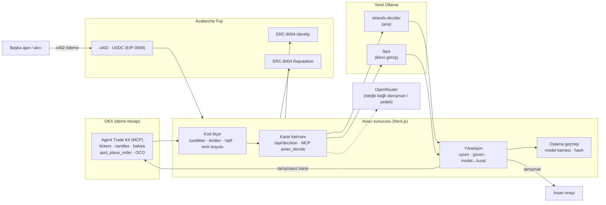

# Aviax · Karar veren katman

> **LLM'ler yazar. Karar modelleri karar verir.**

Aviax, OKX AI ajanları için bir **karar katmanıdır**. Bir ajan "ne yapmalıyım?" diye sorduğunda cevap, bir dil modelinin ürettiği metinden değil, **iki karar modelinin verdiği olasılık dağılımlarından** gelir. Sınırları kod ölçer, kararı modeller verir, emirleri OKX uygular, kimlik ve ödemeler Avalanche'ta tutulur.

Aynı katman iki işte canlı çalışıyor:

| | Ne yapar | Sayfa |
|---|---|---|
| **Şirket risk masası** | Bir şirketin OKX hazinesini 10 sn'de bir okur, risk limitlerini ölçer, müdahale gerekiyorsa **kendisi** kademeli satış emri verir. İnsana sadece tartışmalı kararlar gider. | `/decision` |
| **Otonom trade ajanı** | Parite, yön, boyut, TP/SL ve işleme girme kararını ayrı ayrı olasılık dağılımı olarak alır; spot alım + OCO koruması ile işlem açar. | `/agent` |

Team1 Türkiye × OKX TR **Agentic Hackathon** · Ankara · 17 Ekim 2026

- **Canlı demo:** https://aviax.pages.dev → girişte **"Demoya geç"** (hazır OKX demo şirket hesabı; anahtarlar sunucuda kalır, tarayıcıya gitmez)
- **Avalanche Fuji (ERC-8004):** risk masası [#271](https://testnet.snowtrace.io/nft/0x8004A818BFB912233c491871b3d84c89A494BD9e/271) · trade ajanı biar [#260](https://testnet.snowtrace.io/nft/0x8004A818BFB912233c491871b3d84c89A494BD9e/260)
- **İlk gerçek x402 ödemesi:** [0x0526443c…caae](https://testnet.snowtrace.io/tx/0x0526443c950f970ec47c997e4846311d2914a4d3dd135c001c30d54b24f0caae) (0,01 USDC, Fuji blok 59.600.871)

---

## İçindekiler

1. [Neden karar modeli?](#1-neden-karar-modeli)
2. [Modeller: tamamen yerel](#2-modeller-tamamen-yerel)
3. [Mimari](#3-mimari)
4. [Karar katmanı (OKX AI entegrasyonu)](#4-karar-katmanı-okx-ai-entegrasyonu)
5. [Şirket risk masası](#5-şirket-risk-masası)
6. [Otonom trade ajanı](#6-otonom-trade-ajanı)
7. [OKX entegrasyonu](#7-okx-entegrasyonu)
8. [Avalanche entegrasyonu](#8-avalanche-entegrasyonu)
9. [İş modeli](#9-iş-modeli)
10. [Jüri demosu, güvenlik ve performans](#10-jüri-demosu-güvenlik-ve-performans)
11. [Ölçümler](#11-ölçümler)
12. [Teknoloji, dosya yapısı, API](#12-teknoloji-dosya-yapısı-api)
13. [Kurulum ve çalıştırma](#13-kurulum-ve-çalıştırma)
14. [Bilinen sınırlar ve sırada ne var](#14-bilinen-sınırlar-ve-sırada-ne-var)

---

## 1. Neden karar modeli?

Bugünkü ajanların çoğu bir LLM'e "al mı, bekle mi?" diye sorar ve **metin** cevabı parse etmeye çalışır. Bu üç sorun yaratır:

- **Ölçülemez:** "Bence long" bir risk eşiğine doğrudan bağlanamaz. Metinden sayı çıkarmak gerekir.
- **Kararsız ve yavaş:** Ücretsiz LLM'lerle ölçtüğümüz karar turu 4 ile 108 saniye arasında sürdü; aynı soruya farklı cevaplar, boş yanıtlar, bozuk JSON ve 429 kota hataları aldık.
- **Diğer uç da çözüm değil:** Her öneriyi insana onaylatmak ajanı bir rapor yazarına çevirir. Kurumlar **ölçülebilir ve denetlenebilir otonomi** ister.

**Karar modelleri** metin üretmez. Verilen seçeneklerin her birine **tek bir forward pass** ile olasılık verir. Üç soru tipi var:

| Tip | Ne döner | Örnek |
|---|---|---|
| `choice` | Seçenekler üzerinde dağılım | `{ yes: 0.82, no: 0.06, uncertain: 0.12 }` |
| `score` | Sıralı seviyeler üzerinde dağılım | `["0%","10%","25%","50%","100%"]` |
| `noul` | Bir ifadenin doğru olma olasılığı | `0.91` (limit ihlali var) |

Böylece "p ≥ eşik ise uygula" gibi kurallar doğrudan uygulanabilir, iki modelin uyumu sayıyla ölçülebilir ve her karar kayıt altına alınabilir.

LLM'i yapabildiği işte tutuyoruz: anlatıcı olarak (dağılımları Türkçe açıklar, karara oy vermez) ve isteğe bağlı danışman/yedek olarak. **Kararı karar modeli verir.**

---

## 2. Modeller: tamamen yerel

İki karar modeli de **başka bir servisten çağrılmıyor**. İkisi de [Ollama](https://ollama.com/search?c=decision) kütüphanesinden indirildi ve **bu makinede, yerel olarak** çalışıyor. Bulut API'si, anahtar veya kota yok.

| Rol | Model | Boyut | Bağlam | Ortalama gecikme | Görev |
|---|---|---|---|---|---|
| **Ana karar verici** | `strands-decider` | 1.9B parametre (mxfp8, MLX runner) · 2,0 GB | 4096 | ~1 sn | Kararı verir |
| **İkinci görüş** | `laya` | 421M parametre · 846 MB | 512 | ~0,27 sn | Hızlı doğrulama ve veto |

```bash
ollama pull strands-decider
ollama pull laya
ollama serve
```

Modellere Ollama'nın karar uç noktası **`POST /v1/systemone`** üzerinden ulaşılır (TypeSafe/JEV API formatı):

```json
{
  "model": "strands-decider",
  "state": "Portfolio: BTC 77.9%, USDT 4.8% ... Policy: max weight 40% ...",
  "questions": {
    "verdict": { "type": "choice", "instructions": "Should the company intervene now?",
                 "criteria": { "yes": "...", "no": "...", "uncertain": "..." } },
    "breach":  { "type": "noul", "instructions": "At least one hard policy limit is breached." }
  },
  "keep_alive": "30m"
}
```

Cevap her soru için olasılıkları döndürür. İki model aynı soruya paralel cevap verir; ensemble ağırlığı **0,6 ana + 0,4 ikinci görüş**.

### OpenRouter: sadece yedek ve danışman

OpenRouter karar zincirinin zorunlu bir parçası değildir. Üç yerde, isteğe bağlı kullanılır:

1. **Danışman ajanlar:** Risk masasında en fazla iki ücretsiz OpenRouter modeli sırayla aynı portföyü değerlendirir; ortak karara düşük ağırlıkla katılır ve oylama geçmişinde ayrı görünür.
2. **Yedek:** `DECISION_OPENROUTER_FALLBACK=1` ise, yerel ana model cevap veremediği anda sunucu tarafındaki OpenRouter modeli devreye girer. Normal turlar OpenRouter kullanmaz.
3. **Kendi anahtarınla:** Ajan sihirbazında ve şirket kurulumunda kullanıcı kendi OpenRouter anahtarı ve modeliyle çalışmayı seçebilir.

OpenRouter modellerine de metin değil, her seçenek için olasılık içeren katı bir JSON dağılımı sorulur; aynı normalizasyondan geçer. Anahtar hiçbir zaman tarayıcıya gönderilmez.

**Sahte karar yok:** `strict` modda yerel model cevap vermezse tur atlanır; modelden gelmeyen bir karar üretilmez.

---

## 3. Mimari



İlke: **model karar verir, kod sınırlar, OKX uygular.** Kodun iyi olduğu işleri (kesin limit kontrolü, emir boyutu, lot yuvarlama) kod yapar. Yargı gerektiren işleri (risk seviyesi, müdahale, ne kadar azaltılacağı) modeller yapar.

---

## 4. Karar katmanı (OKX AI entegrasyonu)

Jüri geri bildirimi: OKX AI tarafında karar modeli entegrasyonu yok. Aviax bunu genel bir katman olarak sağlıyor. Herhangi bir ajan aynı sözleşmeyle karar sorabilir:

**HTTP:**

```http
POST /api/decision
{ "state": "...", "questions": { "<anahtar>": { "type": "choice|score|noul", ... } } }
```

**MCP (stdio):** `npm run --silent mcp:decision` → araç adı **`aviax_decide`**. Bir MCP host'una (Claude Code, Cursor, OKX AI ajanı) OKX Trade MCP'nin yanına eklenir.

Her iki yol da aynı çıktıyı verir (`lib/decisionLayer.ts`):

- her model için ayrı dağılım (`primary`, `second`)
- ensemble dağılımı, seçilen cevap (`pick`) ve güven (`confidence`)
- iki modelin uyumu (`agreement`: aynı seçenek + dağılım örtüşmesi)
- modellerin canlı mı olduğu ve gecikmeleri
- kaydın sıralı JSON'unun **keccak256 hash'i** (zincire bağlanabilir karar kaydı)

Şirketler kendi karar endpoint'lerini **x402 ile ücretli** yayınlayabilir: `/api/company/decision/{publicId}` (bkz. [İş modeli](#9-iş-modeli)).

---

## 5. Şirket risk masası

Örnek kurum: **Aviax Yapım İşleri LTD ŞTİ**, OKX demo hazinesi. Kod: `lib/riskDesk.ts`, `app/api/risk`, `app/decision`.

### Bir tur (her 10 saniyede)

1. **Yönlendirme:** Serbest metinli bir talep geldiyse bir karar modeli onu doğru masaya yönlendirir (`risk · portföy · hazine · yönetişim`). Bu demoda risk masası canlı.
2. **Portföy:** OKX bakiyesi okunur (her varlığın USD değeri). Stablecoin ve fiat rezerv sayılır.
3. **Piyasa:** ATK `market_get_candles` ile riskli her varlık için 60 günlük 1D kapanış (5 dk önbellek).
4. **Kod ölçer (deterministik):**
   - en büyük riskli varlığın ağırlığı (yoğunlaşma)
   - stablecoin + nakit rezerv oranı
   - 30 günlük düşüş (drawdown)
   - yıllık oynaklık (günlük getirilerin std × √365)
   - 1 günlük tarihsel VaR %95
   - her biri politikaya göre `ok / yakın / ihlal`
5. **Karar modelleri** (iki model, soru başına bir forward pass):

   | Soru | Tip | Ne için |
   |---|---|---|
   | Müdahale gerekli mi? | choice: evet / hayır / kararsız | **komitenin asıl oyu** |
   | Risk seviyesi | choice: düşük / yükselmiş / kritik | durum sınıflandırma |
   | Risk aksiyonu | choice: koru / dengele / azalt / çık | emir tipini belirler |
   | Stable'a aktarılacak pay | choice: %0 / %10 / %50 / %100 | ek azaltım miktarı |
   | Limit ihlali var mı? | noul | **kodla kıyaslanır** (model ↔ kural) |
   | Drawdown limiti aşıldı mı? | noul | durum doğrulama |

6. **Emir planı:** Kod, limitleri geri getiren **minimum** satışı hesaplar (yoğunlaşma ve rezerv açığı); modelin seçtiği pay kadar ek azaltım eklenir. Büyük düzeltmeler **kademelidir**: tur başına en fazla "tur başına otonom işlem $" kadar, kalan sonraki turlarda yeniden değerlendirilir.
7. **Yönetişim:** İnsan onayı **sadece** şu durumlarda istenir:
   - modeller müdahale sorusunda anlaşamazsa (uyum < %50)
   - güven %55'in altındaysa
   - model, kural kontrolüyle çelişirse (ör. model "ihlal yok" diyor ama kod ihlal ölçüyor)
   - karar tam çıkışsa (`exit`)
8. **Yürütme:** Karar tartışmasızsa satışlar **ATK `spot_place_order`** ile OKX demo hesabında uygulanır ve emir numaraları kaydedilir.
   - Sadece `OKX_DEMO=1` iken emir gider; canlı hesapta asla.
   - **Hesap başına tek yürütme hakkı:** kaç kişi izlerse izlesin aynı hesap 45 sn'de en fazla bir kez işlem görür (çift satış yok).
   - Borsanın reddettiği pariteler hatırlanır ve plandan çıkarılır (OKX TR'de OKB uyum kuralı nedeniyle işleme kapalı).
9. **Kayıt:** Her tur keccak256 hash'li bir karar kaydı üretir ve **oylama geçmişine** yazılır.

### Oylama geçmişi ve model karnesi

Her turda her modelin oyu (ana, ikinci görüş, danışmanlar), ortak karar, kural kontrolü, sonraki turdaki portföy değeri ve sonuç (uygulandı / insan onayı / öneri) saklanır (`data/decisions.json`). Model karnesi şunları gösterir:

- **ortak kararla uyum**
- **kural doğruluğu:** modelin "ihlal var" cevabının kodun ölçtüğü gerçek ihlalle örtüşme oranı. Modelin sözüne değil ölçüme dayandığı için hangi modele güveneceğini seçmenin en sağlam ölçütü.
- ortalama güven, gecikme ve son oy

### Canlı sonuç (OKX demo hesabı, 17 Ekim 2026)

| | Önce | Sonra |
|---|---|---|
| BTC yoğunlaşması (limit %40) | %77,9 | **%37,8** |
| Stable + nakit rezervi (alt limit %20) | %8,7 | **%49** |
| İki modelin müdahale oyu | ana %82 · ikinci %68 · uyum %90 | insan onayı gerekmedi |
| Limitler kapanınca | | modeller **KORU** dedi, satış kendiliğinden durdu |

---

## 6. Otonom trade ajanı

Kod: `lib/agent.ts`, `lib/features.ts`, `lib/fleet.ts`. Her tur bir NDJSON olay akışıdır ve sahnede canlı görselleştirilir.

1. **Tarama:** ATK `market_get_tickers` (SPOT) → likit ve izinli USDT pariteleri (tokenize hisseler hariç).
2. **Özellikler:** ATK `market_get_candles` 1H → trend (EMA20/50), RSI, ATR, hacim z-skoru, birleşik sinyal.
3. **Paralel worker'lar:** Her pariteye iki modele `direction` (al / bekle) ve `quality` (score) sorulur.
4. **Kararlar:** `pair` (choice) → `direction` → `size` (score, bütçe payı, kaldıraç yok) → `tp` / `sl` (ATR katları, choice).
5. **Risk kapısı:** İki ifade sorulur: olgusal "trend ve momentum yukarı" (noul) ve "al / bekle" (choice), model başına ortalanır. Ensemble, yetkideki min. güveni geçmeli; tek bir model %35'in altındaysa **veto** eder. (Eski "pozitif EV" sorusu düşen piyasaya da evet diyordu; boğa/yatay/ayı testleriyle değiştirildi.)
6. **Yürütme:** paper (canlı fiyatla simülasyon) veya OKX demo: ATK `spot_place_order` piyasa alımı → gerçekleşen miktar → ATK `spot_place_algo_order` **OCO** (TP + SL). Korumasız pozisyon yok.

**Filo:** Birden fazla ajan aynı anda çalışabilir. Her ajanın kendi bütçesi ve yetkisi vardır: izinli pariteler, işlem başı limit, günlük işlem sayısı, maks. zarar durdurma, min. güven, tur aralığı, maks. tutma süresi. Bir pariteyi aynı anda tek ajan tutar.

**Fırlatma sihirbazı** (`/agent`): Model (yerel Ollama veya OpenRouter, bağlantı testiyle) → Yetkiler → Fuji'ye fırlat (ERC-8004).

---

## 7. OKX entegrasyonu

**OKX Agent Trade Kit** (`@okx_ai/okx-trade-mcp` 1.4.8), Claude veya Cursor'un kullandığı aynı MCP sunucusu olarak sunucu tarafında başlatılır (`lib/atk.ts`, modüller `market,account,spot`).

| ATK aracı | Nerede |
|---|---|
| `market_get_tickers` | trade ajanı taraması |
| `market_get_candles` | trade özellikleri (1H), risk masası geçmişi (1D) |
| `spot_place_order` | trade alımı, **risk masasının otonom satışları** |
| `spot_place_algo_order` | OCO TP/SL |
| `spot_get_order` | gerçekleşen miktar |

Ayrıca imzalı OKX REST istemcisi (`lib/okx.ts`, `x-simulated-trading: 1`) ile bakiye, emir geçmişi ve trade ekranı (`/trade`: parite listesi, mum grafik, emir defteri, Al/Sat + TP/SL, varlıklar, açık emirler, geçmiş).

Şirket bağlantısı: kurum kendi OKX demo API anahtarını bağlar; anahtar sadece sunucu belleğinde, tarayıcı başına rastgele bir HttpOnly çerezle tutulur, diske yazılmaz ve 24 saatte silinir.

---

## 8. Avalanche entegrasyonu

Ağ: **Avalanche Fuji C-Chain** (chainId 43113). Resmi ERC-8004 v1 kayıtları kullanılır:

| Kontrat | Adres |
|---|---|
| Identity Registry | `0x8004A818BFB912233c491871b3d84c89A494BD9e` |
| Reputation Registry | `0x8004B663056A597Dffe9eCcC1965A193B7388713` |
| Fuji USDC (EIP-3009) | `0x5425890298aed601595a70AB815c96711a31Bc65` |

**Kimlik (ERC-8004):** Her ajan için ayrı bir cüzdan üretilir. Operatör cüzdanı (agentic wallet veya tarayıcı cüzdanı) gas gönderir; ajan **kendi cüzdanıyla** `register(agentURI, metadata)` çağırır, böylece kimlik NFT'si ajanın kendisine aittir. Metadata: model, ikinci görüş, yetki hash'i, şirket ve politika hash'i.

| Ajan | agentId | Sahip | Zincirde doğrulanan metadata |
|---|---|---|---|
| Aviax Yapım Risk Masası | **#271** | `0xFB60…0498` (ajanın kendi cüzdanı) | şirket, iki model, politika hash'i, yetki hash'i |
| biar (trade ajanı) | **#260** | `0x9218…b620` | iki model, yetki hash'i |

**İtibar:** Kapanan her işlem PnL yüzdesiyle Reputation Registry'ye yazılır (`giveFeedback`), kalibrasyon herkesçe denetlenebilir.

**x402 (sadece pazar ve şirket endpoint'leri için):** Sahip kendi ajanını ücretsiz kullanır. Pazara açılan bir ajanın senaryosunu başkası başlatmak isterse:

1. `GET /api/signal/{id}` → **402 Payment Required** + ödeme gereksinimleri
2. Alıcı EIP-3009 `TransferWithAuthorization` imzalar (tarayıcıda `eth_signTypedData_v4` veya agentic wallet)
3. Sunucu facilitator olarak imzayı doğrular ve **Fuji'de settle eder**; USDC ajanın cüzdanına gider
4. Ajan alıcı için canlı bir karar turu çalıştırır ve sahneye akıtır

İlk gerçek satış: agentic cüzdan → biar, 0,01 USDC, tx [`0x0526443c…caae`](https://testnet.snowtrace.io/tx/0x0526443c950f970ec47c997e4846311d2914a4d3dd135c001c30d54b24f0caae), ardından 41 olaylık ücretli senaryo akışı.

> Teknik not: Resmi Fuji RPC'si yoğun kullanımda rate limit uygular; yedek RPC'nin gas tahminleri bozuk olabildiği için tüm zincir yazımları sabit gas limitiyle gönderilir.

---

## 9. İş modeli

- **Kendi ajanın: sadece kârdan.** Ücretsiz kullanılır. Sadece high-water mark üstündeki **yeni kârdan** başarı ücreti alınır (varsayılan %18); zarar eden ajandan ücret alınmaz. Model maliyetini iki durumda da platform taşır.
  Optimal ücret: doğrusal benimseme eğrisi A(f) = 1 − f/F altında platform kârı `f* = F/2 + N·c / (2·E[kâr⁺])` noktasında maksimum (sunumdaki hesaplayıcı).
- **Pazar:** Ajan sahibi senaryo fiyatını belirler; alıcılar x402 ile öder, USDC ajanın cüzdanına gider, platform pay alır.
- **Şirketler:** Kurum kendi karar endpoint'ini sorgu başına fiyatlar (0,000001–100 USDC); başka ajanlar Fuji USDC ile öder.
- Oylama geçmişi ve ERC-8004 itibarı kalibre modelleri öne çıkarır: **karar kalitesi gelire dönüşür.**

---

## 10. Jüri demosu, güvenlik ve performans

**Jüri demosu:** Siteye ilk girişte iki seçenek çıkar: **"Demoya geç"** (tek tık; sunucuda tutulan, salt okunur bir demo şirket oturumu: Aviax Yapım İşleri LTD ŞTİ) veya **"Kendi şirketini bağla"**. Demo oturumunda Fuji kaydı kapalıdır; anahtarlar hiçbir API cevabında dönmez.

**Güvenlik:**
- Otonom emir yalnızca OKX demo modunda; hesap başına tek yürütme hakkı; kademeli işlem limiti.
- Herkese açık linkte botlar, script istemcileri ve headless tarayıcılar engellenir (`middleware.ts`); `robots.txt` ve `X-Robots-Tag` ile indeksleme kapalı. x402 ajan endpoint'i açık kalır.
- Cüzdan işlemleri ve agentic satın alma sadece sunum makinesinden (localhost) yapılabilir.
- `.env*`, `data/` (cüzdanlar, filo, karar geçmişi) git'e girmez.

**Performans:**
- Production derlemesi: sayfalar dev moddaki 7 sn yerine milisaniyeler içinde gelir.
- **Paylaşılan turlar:** Aynı hesap ve politikayı izleyen herkes tek bir model turunu paylaşır (devam eden tura katılır veya son 8 sn'deki sonucu alır); N sekme modelleri N kez değil bir kez çalıştırır.
- **Ollama bellek bakımı:** MLX çalıştırıcısı modeli her turda ~0,2 GB büyütüp geri vermiyordu (2,5 GB → 10,5 GB). Bir model 4 GB'ı geçince ve devam eden çağrı yokken bellekten çıkarılır, sonraki çağrıda 1–3 sn'de temiz yüklenir.
- Sorgular üst üste binmez, gizli sekmeler sorgulamaz; mum grafiği güncellemede sadece son 3 mumu çeker; OKX hesap sorgusu 3 sn paylaşılır.

---

## 11. Ölçümler

**Risk sorularında iki model (aynı üç portföy: sakin, stresli, kritik):**

| | strands-decider | laya |
|---|---|---|
| Doğru cevap (müdahale, risk seviyesi, ihlal) | **9/9** | 7/9 |
| Kritik portföy (4 limit ihlalde) | müdahale %91, kritik %87 | müdahale yok %55, "yükselmiş" |
| Güven | %82–91 | %50–61 |
| Gecikme | ~1 sn | ~0,27 sn |

Bu yüzden **strands-decider karar verir, laya hızlı ikinci görüş olarak doğrular.** laya tek başına kritik durumda yanlış karar veriyor ve güveni eşiğin altında kaldığı için otonomiyi fiilen kapatıyor.

**Masa yönlendirme:** Dört örnek talepte (risk, hazine, portföy, yetki) ana model doğru masayı seçti (risk %96, hazine %84, portföy %99, yönetişim %89).

**LLM ↔ karar modeli:**

| | LLM ajanı | Karar modeli |
|---|---|---|
| Karar anındaki çıktı | Metin (parse gerekir) | Olasılık dağılımı |
| Hız (ölçümümüz) | Ücretsiz LLM'ler: tur başına 4–108 sn | strands-decider ~20–900 ms · laya ~90–170 ms (tek soru) |
| Tekrarlanabilirlik | Aynı soruya farklı cevap | Aynı girdi, aynı dağılım |
| Hata türü | Boş cevap, bozuk JSON, 429 | Model kapalıysa açık hata, sahte karar yok |
| Risk kuralına bağlanma | Metinden sayı çıkarmak gerekir | `p ≥ eşik` doğrudan uygulanır |
| Nerede çalışır | Bulut API, anahtar, kota | Yerel Ollama, 0,8–2 GB |

---

## 12. Teknoloji, dosya yapısı, API

**Stack:** Next.js 15.5 (App Router) · React 19 · TypeScript 5.9 · Tailwind 3.4 · framer-motion 11 · lightweight-charts 4.2 · viem 2.57 · @modelcontextprotocol/sdk 1.32 · @okx_ai/okx-trade-mcp 1.4.8 · Ollama · Cloudflare (tunnel + Pages).

Tasarım: [doany.ai](https://doany.ai) esinli; beyaz zemin, Anton / Figtree / JetBrains Mono, sarı `#FFC700`, koyu "sahne" panelleri.

```
app/
  page.tsx              ana sayfa + filodaki ajanın canlı son turu
  decision/             şirket risk masası (sahne, oylama geçmişi)
  agent/                fırlatma sihirbazı, filo, pazar, karar sahnesi
  trade/                OKX demo spot ekranı
  company/              şirket bağlama
  pitch/                sunum (11 slayt)
  api/                  bkz. aşağıdaki tablo
components/
  decision/             RiskField (olasılık alanı), RiskStage, VoteHistory
  agent/                DecisionField, PipelineRail, WorkerGrid, DistributionCard, Ledger, Launch, Fleet, Market
  wallet/               cüzdan bağlama / agentic wallet, OKX varlıkları
  DemoGate.tsx          jüri demo seçimi
lib/
  decide.ts             model sağlayıcıları (Ollama, OpenRouter, TypeSafe), normalizasyon, Ollama bellek bakımı
  decisionLayer.ts      iki koltuklu ensemble, uyum, kayıt hash'i, masa yönlendirme
  riskDesk.ts           risk masası turu, yönetişim, otonom yürütme
  decisionHistory.ts    oylama geçmişi ve model karnesi
  agent.ts features.ts  trade ajanı
  fleet.ts              ajan filosu, zamanlayıcı, Fuji fırlatma, başarı ücreti
  atk.ts okx.ts         OKX Agent Trade Kit (MCP) ve imzalı REST
  chain.ts x402.ts      Avalanche Fuji: ERC-8004, USDC, x402 facilitator
  companySession.ts     şirket oturumları (bellekte)
scripts/
  aviax-decision-mcp.ts MCP sunucusu (aviax_decide)
  publish-link.sh       aviax.pages.dev'i yeni tünele yönlendirir
middleware.ts           herkese açık istek etiketi, bot engeli
```

| Rota | Ne yapar |
|---|---|
| `POST /api/decision` | genel karar katmanı `{ state, questions }` |
| `POST /api/risk` | risk masası turu (NDJSON akış, paylaşılan turlar) |
| `GET /api/risk/history` | oylama geçmişi + model karnesi |
| `/api/company/connect · settings · launch · activity` | şirket bağlantısı, ayarlar, Fuji kaydı, hesap etkinliği |
| `GET/POST /api/company/decision/{id}` | şirketin x402 ücretli karar endpoint'i |
| `/api/fleet`, `/api/fleet/{id}`, `/api/fleet/{id}/events` | ajan filosu ve aksiyonlar |
| `POST /api/agent` | emirsiz deneme turu |
| `GET /api/signal/{id}` | pazar senaryosu (402 → ödeme → akış) |
| `/api/market`, `/api/account`, `/api/order` | piyasa, hesap, spot emir |
| `/api/models`, `/api/models/test` | kurulu yerel modeller, bağlantı testi |
| `/api/chain`, `/api/wallet` | Fuji durumu, agentic wallet |

---

## 13. Kurulum ve çalıştırma

Gereksinimler: Node 20+, [Ollama](https://ollama.com), OKX **demo** hesabı API anahtarı (Demo Trading → API).

```bash
git clone https://github.com/justbiar/aviax.git && cd aviax
npm install

ollama pull strands-decider
ollama pull laya
ollama serve

cp .env.example .env.local     # değerleri doldur
npm run dev                    # http://localhost:3000
```

Sunum / jüri için production (ayrı klasöre derler, dev sunucusunu bozmaz):

```bash
npm run build:prod && npm run start:prod
```

Herkese açık link:

```bash
cloudflared tunnel --no-autoupdate --url http://localhost:3000
scripts/publish-link.sh https://<tünel>.trycloudflare.com    # aviax.pages.dev'i günceller
```

`.env.local` değişkenleri (değerler asla commit edilmez):

| Değişken | Açıklama |
|---|---|
| `OKX_API_KEY`, `OKX_SECRET_KEY`, `OKX_PASSPHRASE` | OKX demo API |
| `OKX_DEMO=1` | simüle işlem (otonom emir için zorunlu) |
| `JEV_PROVIDER=endpoint`, `JEV_BASE_URL=http://localhost:11434/v1/systemone`, `JEV_MODEL=strands-decider` | ana model |
| `LAYA_ENDPOINT=http://localhost:11434/v1/systemone`, `LAYA_MODEL=laya` | ikinci görüş |
| `FUJI_RPC_URL`, `FUJI_PRIVATE_KEY` | Fuji operatör cüzdanı (agentic wallet oluşturulursa o kullanılır) |
| `OPENROUTER_API_KEY`, `OPENROUTER_MODEL`, `DECISION_OPENROUTER_FALLBACK` | isteğe bağlı danışman / yedek |
| `SUCCESS_FEE_PCT`, `OLLAMA_TRIM_GB` | isteğe bağlı (varsayılan %18, 4 GB) |

MCP olarak kullanmak için (repo kökünde):

```bash
npm run --silent mcp:decision
```

---

## 14. Bilinen sınırlar ve sırada ne var

**Sınırlar (dürüstçe):**
- Her şey OKX **demo** hesabında ve Fuji **test ağında** çalışıyor; gerçek para yok.
- Demo bu makinede çalışıyor ve Cloudflare tüneline bağlı; makine kapanırsa demo durur.
- OKX TR, OKB paritesini uyum kuralı nedeniyle işleme kapatıyor; risk masası bunu hatırlayıp diğer varlıklarla plan kuruyor.
- Karar kayıtları hash'li ama henüz zincire yazılmıyor; `aviax_decide` OKX AI'da kayıtlı bir A2MCP servisi değil.
- Portföy, hazine ve yönetişim masaları yönlendirmede tanımlı; şu an canlı olan risk masası.

**Sırada:**
- Uygulanan kararların hash'ini ERC-8004 metadata'sına yazıp denetimi zincire taşımak.
- `aviax_decide`'ı OKX AI'da A2MCP servisi olarak yayınlamak; diğer masaları açmak.
- Oylama geçmişinden Brier skoru ve güvenilirlik eğrisi; laya'yı kendi sonuçlarımızla fine-tune etmek.
